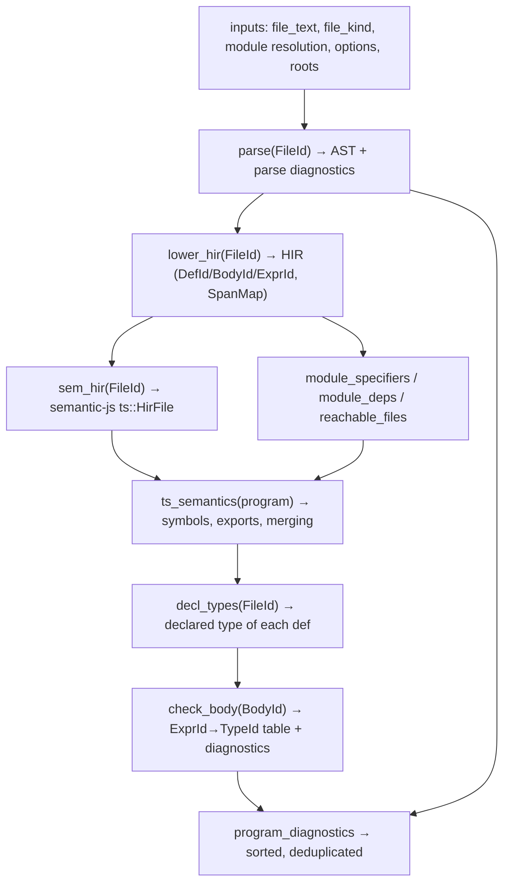

# The engine: how it should work

The target operating model for the semantic engine — the answer to "how should our
engine work?". [overview.md](./overview.md) describes what exists; this page describes
the steady state we are converging on and why. Where current code deviates, the
deviation is named. (Derived from `AGENTS.md`'s playbook plus the implemented salsa
design in `typecheck-ts/src/db/`.)

## Operating model in one paragraph

The host owns the world: file texts, file kinds, module-resolution answers, compiler
options, lib files. It hands these to the engine as **revisioned inputs**. Everything
else — ASTs, HIR, symbol tables, export maps, declared types, per-body type tables,
diagnostics — is a **pure, memoized, cancellable derived query** over those inputs.
Same inputs, same outputs, bit-for-bit, at any thread count. Edits advance a revision;
queries revalidate cheaply and recompute only what their dependency traces require.

## Inputs (the host boundary)

Supplied via the `Host` trait and seeded into the salsa `Database`
(`typecheck-ts/src/db/inputs.rs`):

- `file_text(FileKey) -> Arc<str>` — UTF-8 always; byte-validity is the host's job.
- `file_kind(FileKey) -> Js | Jsx | Ts | Tsx | Dts`
- `resolve(from: FileKey, specifier: &str) -> Option<FileKey>` — module resolution is
  **host policy**, not engine policy ([vision non-goal](../vision.md#non-goals)).
- `compiler_options() -> CompilerOptions` — semantic switches (strictness, target,
  libs, JSX mode) are revisioned inputs; changing them invalidates dependents.
- `lib_files() -> Vec<LibFile>` — ambient `.d.ts` world; bundled TS 5.9.3 libs by
  default.

`Program` owns the mapping `FileKey ↔ FileId` so host keys (paths, virtual names)
can never collide with bundled libs or synthetic files.

## The query DAG

Coarse-grained by design — per file, per def, per body; never per expression:

Why this granularity: expression-level queries would create millions of dependency
edges and drown the memoization system in bookkeeping; file/def/body queries match the
natural units of invalidation (an edit dirties a body, occasionally a def signature,
rarely the module graph) while keeping the dependency graph small enough to validate in
microseconds. The one deliberate consequence: asking "type of expression X" goes
through its body's side table (`BodyCheckResult`), not through a per-expression query.

## Units of work and parallelism

`check_body(BodyId)` is **the** unit of checking work. Each body check:

1. builds the control-flow graph for the body,
2. runs the flow-sensitive typing pass (bidirectional typing, narrowing, inference),
3. produces side tables (`ExprId → TypeId`, pattern types, resolved symbols) and
   diagnostics.

Bodies are embarrassingly parallel *given* immutable global context (symbol tables,
declared types, the type store). The parallel shape must be: **pure map over bodies,
then an order-fixed, associative reduction** — never accumulation into shared mutable
state. Interners are the only shared-write structures, and they must be lock-safe under
the rules in [determinism](./determinism.md#lock-discipline) (a violated rule here is
the root cause of the one known deadlock).

Cancellation is cooperative: an `AtomicBool` token flows in as a revisioned input;
long-running queries check it and unwind with a `Cancelled` payload that the outer
layer converts into a `CANCEL####` diagnostic. Nothing in the engine may block
indefinitely without observing the token.

## Memory model

- **Persistent, shared, immutable**: parsed ASTs, HIR files, symbol-table snapshots,
  and the type store live behind `Arc`; snapshots never mutate after publication.
- **Ephemeral, per-body**: constraint sets, flow environments, and worklists should
  live in a per-body arena (`bumpalo`) and die with the query. (Allocation-count
  benches — `body_alloc`, `check_body_alloc` — exist to keep this honest.)
- **Interned, append-only**: types, shapes, signatures, names — content-addressed IDs;
  see [determinism](./determinism.md). Caches that can grow without bound (relation
  cache, instantiation cache, evaluator caches) are sharded and stats-instrumented so
  hit rates are measurable and eviction can be added where profiles demand it.

## Public API contract

Downstream consumers get a small, stable vocabulary — `Program`, `FileKey`/`FileId`,
`DefId`, `BodyId`, `ExprId`, `TypeId`, `Diagnostic` — and these guarantees:

- `program.check()` → all diagnostics for reachable files, deterministically sorted.
- `program.check_body(body)` → per-body result, cached; repeated calls are free.
- `type_of_def`, `type_of_expr`, `exports_of`, `body_of_def`, `symbol_at`, `type_at`,
  `display_type` — query-shaped access, no AST exposure.
- Offset queries (`type_at`, `symbol_at`) return the *smallest covering* entity, byte
  offsets in UTF-8.
- Serializable snapshots (`serde` feature) with a `schema_version` for downstream
  caching and golden tests.

Internals — arenas, caches, salsa storage, AST pointers — are `doc(hidden)` or private;
consumers must never need them. If a consumer needs a new fact, we add a query, not an
escape hatch.

## Error doctrine

Three severities of "something went wrong", never blurred
(details in [diagnostics](./diagnostics.md)):

- **User-program errors** → diagnostics with stable codes; checking continues.
- **Host/environment failures** (missing file, I/O) → `HOST####` diagnostics and/or
  typed errors at the orchestration boundary.
- **Engine bugs** → never panic across the API; convert to `ICE0001` diagnostics with
  reproduction context. Panics are only legitimate as internal cancellation transport.

## Current deviations from this model

Tracked in [roadmap](../status/roadmap.md). As of 2026-07-23 evening, the two largest
deviations were closed: **body checking is salsa-first** (`check_body_tracked` in
`db/queries/body_check.rs`; the seeding path — `set_body_result`,
`clear_body_results`, `BodyResultInput` — is deleted; memoization is proven by
`tests/salsa_body_memo.rs`: zero re-checks on no-edit, file-granular invalidation on
body edits, correct invalidation on decl-type changes), and **the checker holds no
raw AST pointers** (`AstIndex<'ast>` uses borrows built per query; zero
`unsafe impl Send/Sync` in the crate).

The load-bearing pattern that made salsa-first work, worth knowing before editing:
`ProgramState` publishes a `BodyCheckContext` (interned decl types, bindings,
exports, semantics — deliberately no per-file syntax) as a salsa **input**, and a
tracked wrapper query is the **backdating firewall**: the context's semantic
`PartialEq` lets salsa backdate when a rebuild produces an equal context, which is
what makes unrelated-file edits cheap. Two invariants protect it (documented at the
sites): `ts_semantics` must not read `lower_hir`, and the context's span→def map
resolves collisions deterministically. `DEBUG_BODY_CTX_EQ=1` prints which context
field defeated backdating.

Remaining deviations:

1. **Declaration types are still computed imperatively** and enter salsa only via the
   published context — the second half of dual-brain unification. Consequence: a
   decl-type change re-checks all bodies (correct but coarse); per-file context
   slices are the natural tightening.
2. **AST consumption** is now safe (borrows) but not yet HIR-only: nine files still
   import `parse_js::ast` (inventory in the roadmap). JSX element structure prefers
   HIR `JsxElement` (AST residual when missing); class-member / type-expression
   detail still drives some AST walks.
