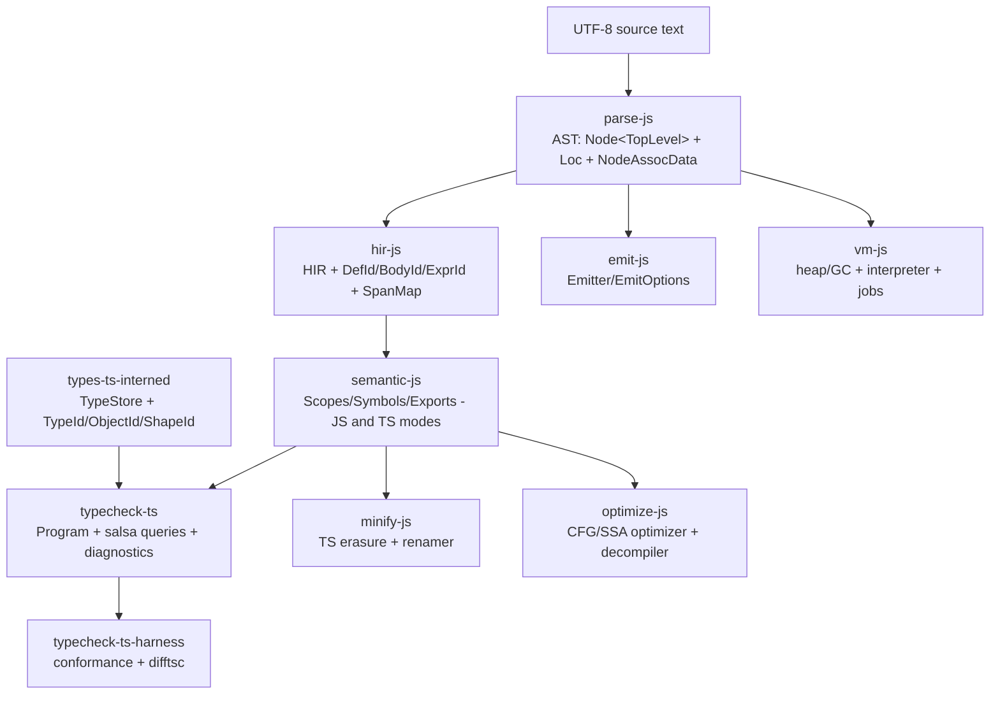

# Architecture overview

What exists today, how the crates connect, and an honest assessment of where the
current structure is and isn't ideal. The *target* operating model lives in
[engine.md](./engine.md); the doctrine that makes it trustworthy lives in
[determinism.md](./determinism.md). (Absorbed from `docs/architecture.md`,
`docs/deps.md`, and `README.md`, 2026-07; extended with assessment.)

## Data flow at a glance

The layering is strict in one direction: syntax (`parse-js`) knows nothing of
semantics; semantics (`hir-js`, `semantic-js`) knows nothing of types;
`types-ts-interned` is pure (no AST references, no spans); `typecheck-ts` composes all
of them behind the `Program` facade. `emit-js` consumes syntax (and HIR) only.
`diagnostics` sits below everything as the shared currency.

## Crate inventory

| Crate | Role | Depth |
| --- | --- | --- |
| `diagnostics` | `FileId`/`TextRange`/`Span`/`Diagnostic`, deterministic ordering, rustc-style rendering | [architecture/diagnostics](./diagnostics.md) |
| `parse-js` | Hand-written lexer + recursive-descent parser, JS/JSX/TS/TSX/DTS/Ecma dialects, full TS type grammar | [crates/parse-js](../crates/parse-js.md) |
| `hir-js` | AST → HIR lowering; content-addressed `DefId`/`BodyId`; `SpanMap`; per-def type arenas | [crates/hir-js](../crates/hir-js.md) |
| `semantic-js` | JS mode (scope tree + resolution for minify/optimize) and TS mode (three namespaces, merging, export maps) | [crates/semantic-js](../crates/semantic-js.md) |
| `types-ts-interned` | Interned type representation + relation engine + evaluator; pure | [crates/types-ts-interned](../crates/types-ts-interned.md) |
| `typecheck-ts` | The checker: `Program`/`Host` API, salsa DB, body flow-checking, bundled libs | [crates/typecheck-ts](../crates/typecheck-ts.md) |
| `emit-js` | Deterministic printer (AST and HIR backends), ASI/precedence aware | [crates/emit-js](../crates/emit-js.md) |
| `minify-js` (+ `-cli`, `-nodejs`) | TS erasure + scope-aware renaming + minified emit; published | [crates/minify-js](../crates/minify-js.md) |
| `optimize-js` (+ `-debugger`) | IL/CFG/SSA optimizer and decompiler; optional typed mode | [crates/optimize-js](../crates/optimize-js.md) |
| `vm-js`, `runtime-js`, `webidl`, `webidl-vm-js` | ECMAScript VM: GC heap, interpreter, jobs/promises, WebIDL embedding | [crates/vm-js](../crates/vm-js.md) |
| `typecheck-ts-harness`, `conformance-harness`, `test262`, `test262-semantic`, `megatest`, `bench/*`, `fuzz` | Verification infrastructure | [engineering/testing](../engineering/testing.md) |
| `parse-js-cli`, `typecheck-ts-cli` | Debug/driver CLIs | on their crate pages |

## Where IDs and spans live

The span/ID discipline is the workspace's connective tissue:

- **`diagnostics`**: `FileId` wraps stable per-program file indices. `TextRange
  { start, end }` is always UTF-8 byte offsets; `Span { file, range }` is the shared
  diagnostic currency.
- **`parse-js`**: emits `Node<TopLevel>` with `Loc(start, end)`; mutable
  `NodeAssocData` hosts small attachments (scope IDs, string code units, markers).
- **`hir-js`**: assigns deterministic `DefId`/`BodyId`/`ExprId`/`TypeExprId` from
  `DefPath`/`BodyPath` hashes and builds `SpanMap` indices for byte→ID lookups.
- **`semantic-js`**: JS mode writes `ScopeId`/`DeclaredSymbol`/`ResolvedSymbol` into
  `NodeAssocData`; TS mode returns immutable symbol tables/export maps keyed by
  deterministic `SymbolId`/`DeclId` plus export-name strings (ordered `BTreeMap`s).
- **`types-ts-interned`**: `TypeId`/`ShapeId`/`ObjectId`/`SignatureId` derive from
  stable hashes of canonical data; **no spans leak into this layer**.
- **`typecheck-ts`**: diagnostics carry `Span`; public queries return opaque IDs plus
  per-body side tables.

Only syntax layers own byte offsets; semantic/type layers traffic in IDs; diagnostics
attach `Span` at the boundary. This lets consumers render errors without threading AST
pointers through the system.

## Dependency graph

The live workspace dependency graph is generated into [deps.md](./deps.md) by
`scripts/gen_deps_graph.sh` (also `just docs`; CI fails if it drifts). Edges are
workspace-only; the generator includes optional dependencies and does not mark them —
for example `optimize-js → typecheck-ts` is the off-by-default `typed` feature.

## Assessment: is the current structure ideal?

Verdict at the macro level: **yes — keep it**. The crate decomposition matches both the
north-star design and the shape mature language engines converge on (rustc /
rust-analyzer lineage): one syntax truth, stable-ID HIR, a single semantics layer, a
pure interned type core, a query-driven checker facade, and verification as first-class
crates. No crate merge or split at the workspace level is currently warranted, with one
watch item (below).

The deviations worth acting on are *inside* crates, plus a few workspace-hygiene items.
Each links to a roadmap entry; details and evidence live on the crate pages.

**Structural (design) deviations:**

1. **`typecheck-ts` dual brain — half resolved (2026-07-23).** Body checking is now a
   salsa-tracked query with the seeding path deleted and memoization proven (see
   [engine § current deviations](./engine.md#current-deviations-from-this-model) for
   the backdating-firewall pattern and its invariants). The remaining half:
   declaration types are still computed imperatively and enter salsa via the
   published context. ([roadmap](../status/roadmap.md#2-structural-refactors))
2. ~~**`check/hir_body.rs` monolith**~~ — resolved 2026-07-23: decomposed into a
   10-module tree under `check/` (largest file 1,981 lines), behavior-frozen and
   baseline-verified. Module map in
   [crates/typecheck-ts](../crates/typecheck-ts.md).
3. ~~**`AstIndex` raw pointers**~~ — resolved 2026-07-23: `AstIndex<'ast>` holds
   borrows, built per body-check query; zero `unsafe impl Send/Sync` in the crate
   (the only remaining `unsafe impl`s are salsa's designed `Update` extension
   point). AST access is safe but not yet HIR-only (nine files still import
   `parse_js::ast`).
4. ~~**Body-local bindings → `LocalId`**~~ — done 2026-07-24 (Wave 3):
   params/vars/catch in `Body.locals` with no body-local DefIds;
   `type_of_local` for checker queries. See
   [hir-js](../crates/hir-js.md#the-id-scheme-the-crates-core-idea).
5. ~~**Harness mechanics duplication**~~ — **done 2026-07-24**:
   `typecheck-ts-harness` consumes `conformance-harness` for expectations,
   `FailOn`, and index/hash `Shard`/`ShardStrategy`. Report shapes and `tsc`
   process timeouts remain harness-local by design.

**Hygiene items (mechanical):**

- ~~`Cargo.toml` workspace members duplicates~~ — fixed 2026-07-23.
- ~~`docs/deps.md` stale~~ — generator repointed to [deps.md](./deps.md) and
  regenerated 2026-07-23.
- ~~`vm-js` non-compiling~~ — fixed 2026-07-23; see [health](../status/health.md).
- ~~NameInterner lock discipline~~ — fixed 2026-07-23; case study in
  [determinism](./determinism.md#case-study-the-nameinterner-deadlock).

**Things that look odd but are deliberate (do not "fix"):**

- Two semantics modes in one crate (`semantic-js::js` vs `::ts`): intentional — one
  crate so the modes never drift; different consumers need different cost profiles.
- `parse-js` accepts TS syntax in `optimize-js`'s default pipeline (dialect `Ts`):
  intentional, so typed pipelines can share the parse.
- The emitter having both AST and HIR backends: intentional during migration —
  production minify emits from HIR and errors rather than silently falling back; the
  AST path is exercised in tests for parity. Eventually the AST backend shrinks.
- `typecheck-ts` bundling TypeScript's `lib.*.d.ts` (5.9.3) behind `bundled-libs`:
  intentional for offline/hermetic checking; hosts can supply their own libs.
